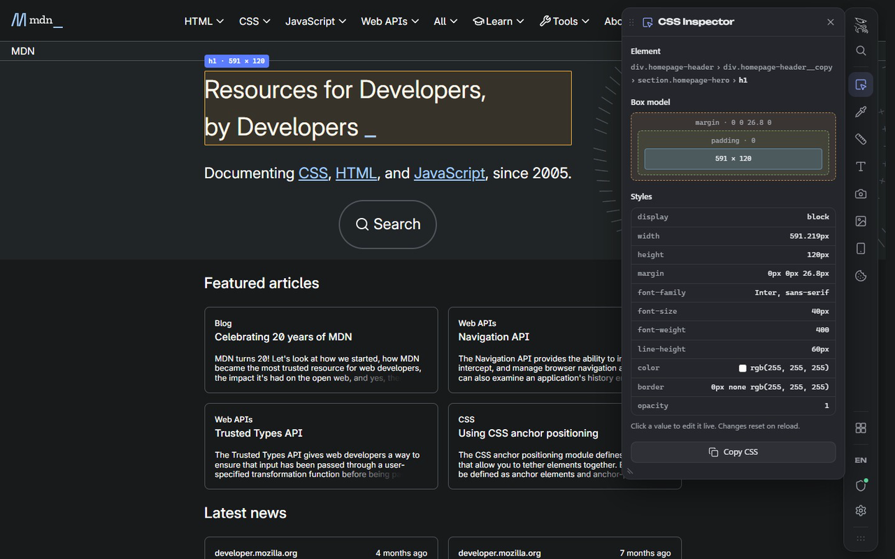
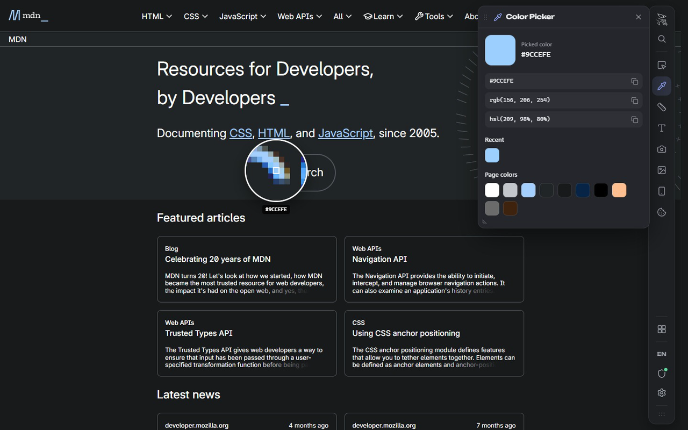
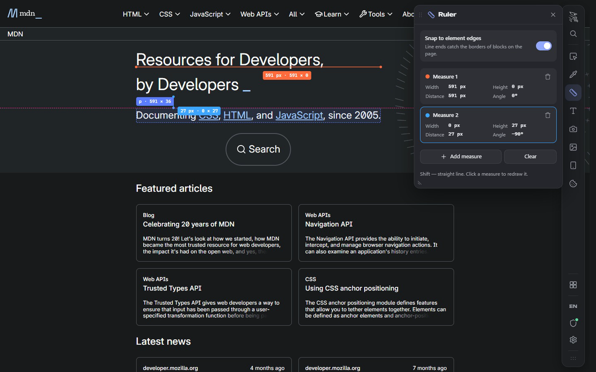
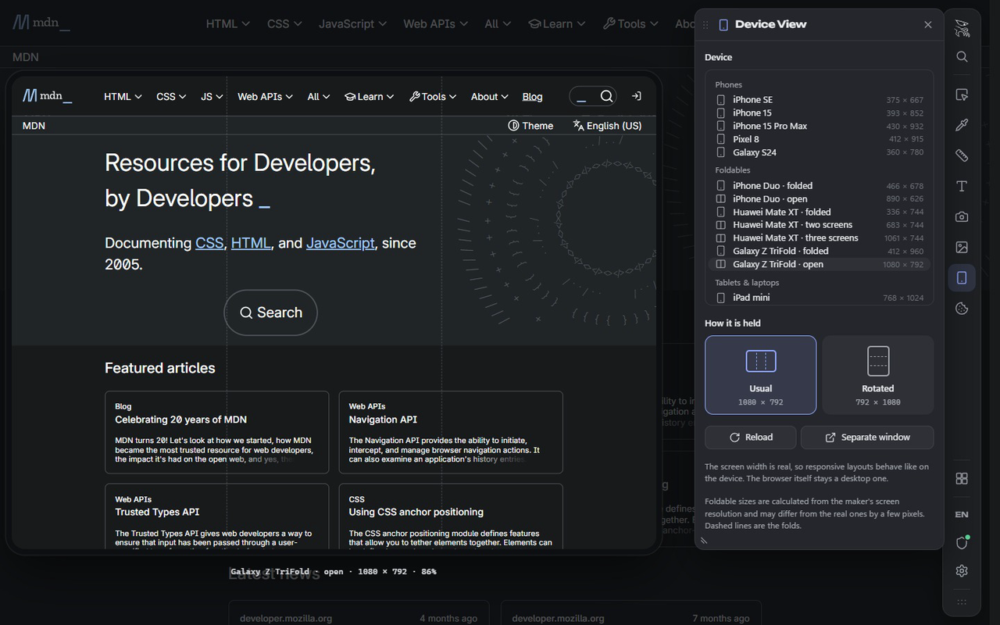

# Kestrel Inspector

https://github.com/user-attachments/assets/da815ce8-2c62-4107-93ab-8113064f2203

| | |
|---|---|
|  |  |
|  |  |

Free toolkit for web developers and designers, in a panel on any page: CSS inspector, color picker,
ruler, fonts, site stack, SEO & link preview, device view (phones, foldables, tablets), page editor,
dark mode, custom CSS/JS, outlines & grids, screenshots, page images, cookies, JSON & encoder.

- Works locally. No servers, no analytics, no tracking, no remote code.
- Minimal permissions: `activeTab`, `scripting`, `storage`. Cookies, downloads and per-site access
  are optional and requested only when a tool needs them.
- The packaged code is plain, unminified JavaScript compiled from the TypeScript in `src/`.

## Install

**Firefox / Zen:** [Kestrel Inspector on addons.mozilla.org](https://addons.mozilla.org/firefox/addon/kestrel-inspector/), or download `kestrel-inspector-<version>-firefox.xpi` from [Releases](https://github.com/cipheroute/kestrel-inspector/releases/latest) and drag it into the browser window (it is signed by Mozilla).

**Chrome, Edge, Brave, Opera, Vivaldi** (until the Chrome Web Store version):

1. Download `kestrel-inspector-<version>-chrome.zip` from [Releases](https://github.com/cipheroute/kestrel-inspector/releases/latest) and unzip it.
2. Open `chrome://extensions` (in Edge: `edge://extensions`).
3. Turn on **Developer mode** (top right).
4. Click **Load unpacked** and choose the unzipped folder.

**Firefox и Zen:** [страница в каталоге Mozilla](https://addons.mozilla.org/firefox/addon/kestrel-inspector/) или скачай `…-firefox.xpi` из [релизов](https://github.com/cipheroute/kestrel-inspector/releases/latest) и перетащи в окно браузера.

**Установка в Chrome и подобных:** скачай `…-chrome.zip` из [релизов](https://github.com/cipheroute/kestrel-inspector/releases/latest), распакуй, открой `chrome://extensions`, включи «Режим разработчика» справа вверху, нажми «Загрузить распакованное» и выбери распакованную папку.

## Build

Requirements: Node.js 22 or newer, npm.

```sh
npm ci
npm run build
```

This compiles `src/` with the TypeScript compiler (no bundler, no minifier) and writes:

- `dist/firefox/` — the Firefox / Zen build (this is what is uploaded to addons.mozilla.org)
- `dist/chrome/` — the Chromium build

`scripts/build.mjs` only runs `tsc`, copies `assets/` and writes `manifest.json` for each browser.

## License

PolyForm Noncommercial 1.0.0 with an additional permission — see `LICENSE.md`.
Third-party material — see `THIRD_PARTY.md`.

Author: cipheroute
